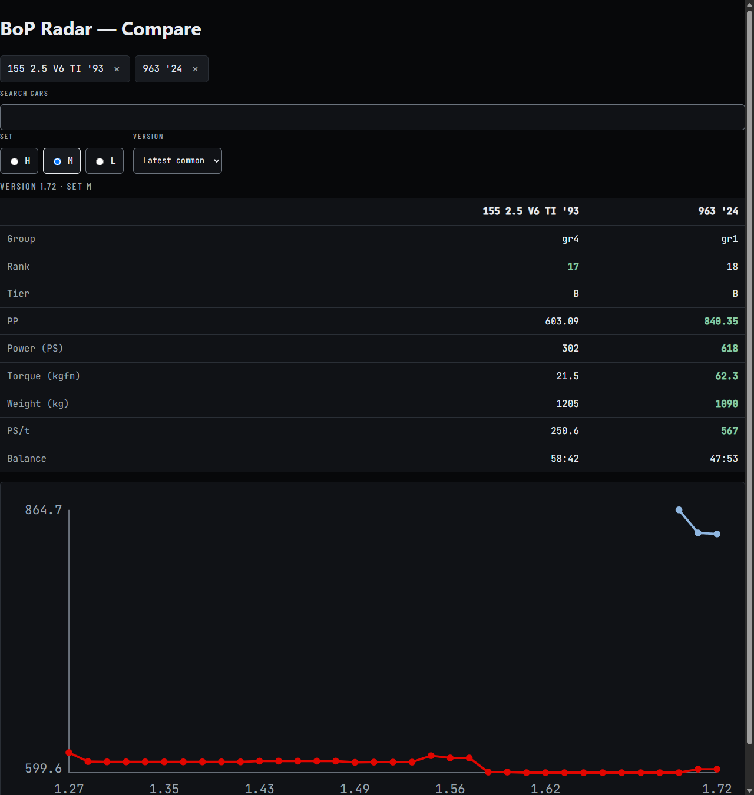

# GT7 BoP Radar

**Gran Turismo 7 Balance of Performance radar** for Gr.1, Gr.2, Gr.3 and Gr.4 cars — live at **https://francmarra.github.io/bop-radar/**

Every BoP update since version 1.15, with a verdict per car (buff / nerf / mixed) and a short
performance context: which track type it suits (high-, mid- or low-speed BoP), strengths and
weaknesses, estimated tyre wear and fuel use. Cars are **ranked by real Daily Race pace**, and a
**Daily Race guide** shows the best cars for each race, from this week's live leaderboards when available. A **balance
index** (how many cars really share the Daily Race top 100) rates each BoP update. English and Portuguese UI.

- `src/gt7bop/` — Python (stdlib only) pipeline: fetch → parse → build history → assess → JSON
- `site/` — static SPA source (vanilla JS, no build step) reading `site/data/`
- `dist/` — deploy build: `site/` + one pre-rendered page per URL (`car/<id>/`, `update/<v>/`, `week/`…), sitemap, share images
- `data/leaderboards/<board>.json` — per-car pace aggregates of finished Daily Races (no player data)
- `data/notes/<car-id>.toml` — optional hand-written notes shown on a car's page (`text = "..."`)
- `data/car_images.toml` — car id → GT7 car id, used to fetch the official car pictures at build time
- `api/` — ASP.NET Core 9 read-only REST API over `site/data` (PostgreSQL, Docker, xUnit)
- `web/` — React + TypeScript car comparator (Vite) on top of the API, see [Car comparator (React)](#car-comparator-react)

## Usage

```sh
uv sync
uv run gt7bop update            # fetch missing pages, rebuild site/data
uv run gt7bop update --refresh  # re-download the live pages (new game version)
uv run gt7bop update --offline  # rebuild from cache only
uv run gt7bop leaderboards --pages 26  # aggregate the last ~52 weeks of Daily Races (incremental)
uv run pytest
py -m http.server -d site 8765  # quick dev: http://127.0.0.1:8765 (SPA only)
uv run --extra render gt7bop render --out dist --site-url http://127.0.0.1:8765/  # full build: pages, sitemap, share images
uv run --extra render gt7bop render --out dist --images  # same, plus the official car pictures (see below)
py -m http.server -d dist 8765
uv run gt7bop images            # map new cars to GT7 ids -> data/car_images.toml (prints the ones still unmapped)
uv run gt7bop evaluate          # backtest the ranking on unseen Daily Races
uv run gt7bop check --baseline <old site/data> --max-age 2  # sanity checks the Action runs before committing data
```

The scheduled Action stops before committing or deploying when `check` finds broken, missing, shrinking or regressing
data (the live site keeps its last good data), and opens an `action-alert` issue on any failure or stale-data warning;
the next healthy run closes it.

## How cars are assessed

| Output | Method |
|---|---|
| Rank / level | per class and BoP track type: **real pace** from Daily Race leaderboards on every layout of that type (≥ 2 layouts with ≥ 10 laps under the current BoP; same 70/30 blend as the per-track rating; unproven cars capped at the median), otherwise the model estimate; S top 10 %, A ≤35 %, B ≤70 %, C rest. PP rank is kept for reference |
| Verdict | average power-to-weight change over the BoP sets that changed: > +0.25 % buff, < −0.25 % nerf |
| Track fit | ½ PP rank + ½ the traits each track type rewards (PS/t, rotational G at 60/120/240 km/h, 100–150 km/h acceleration) |
| Strengths | top / bottom quarter of the group |
| Per-track rating | 70 % leaderboard pace on that layout (median of a car's best 20 laps vs. the event's 20 fastest, top 1000 laps; 6-month half-life, ×0.4 if the car's BoP changed since) + 30 % track-type fit; no data → fit × 0.85 |
| Tyre wear, fuel | **heuristic estimates** from weight, torque, drivetrain and power relative to the group |

### Does it work? (backtest)

`uv run gt7bop evaluate` predicts each Gr.3/Gr.4 Daily Race (≥ 8 matched cars) using **only earlier races** and BoP
changes already released at the time, then compares the predicted order with the real one (Spearman ρ):

| Ranking | mean ρ (40 events) | better in |
|---|---|---|
| Real-pace ranking (this site) | **+0.25** | 65 % of events |
| PP under BoP (the usual proxy) | +0.14 | 35 % |

Rules (chosen up front, then checked against 17 alternatives — none scored higher): a layout counts as evidence
with ≥ 10 laps under the car's current BoP; "real pace" needs ≥ 2 layouts; cars with no evidence are capped at the
median real-pace score. Caveats: 40 events is a small, noisy sample; car model fit and PP ranks in the backtest are
today's values, not the historical ones; in the top 1000 laps a few meta cars hold most laps, so many cars have little
evidence. Deeper and older leaderboard data is the main lever for accuracy.

## Data & credits

- BoP values: [GT ENG!NE](https://gt-engine.com/gt7/) car-spec pages and archives (cached locally,
  fetched politely, at most daily). Where the source's "Old" values disagree with its previous "New"
  values, the change shows up as *mixed*.
- Leaderboards: official Daily Race rankings via [gtsh-rank.com](https://gtsh-rank.com/daily/) — only
  car/lap-time aggregates are stored.
- Track → BoP set and car ids: [ddm999/gt7info](https://github.com/ddm999/gt7info) (MIT-0).
- Car images © Polyphony Digital Inc. / Sony Interactive Entertainment. They are **downloaded at build time only**
  (`render --images`, into the git-ignored `cache/car-images/`), converted to WebP inside `dist/` and **never
  committed** to this repository. Building without `--images` removes every picture (cars fall back to a neutral
  silhouette) — that is the kill switch if the rights holder asks: drop the flag from the workflow.
- Unofficial fan project, not affiliated with Polyphony Digital or Sony Interactive Entertainment.

## Roadmap

- Replace the tyre/fuel estimates with real per-car data exported from
  [gt7-telemetry](https://github.com/francmarra).

MIT licence.

## API (.NET)

[](https://github.com/francmarra/bop-radar/actions/workflows/api.yml)

Read-only REST API over the generated data (ASP.NET Core 9, EF Core, PostgreSQL, Docker, xUnit):

`Python pipeline → site/data/*.json → importer → PostgreSQL → ASP.NET Core API`

```sh
cd api && cp .env.example .env && docker compose up
```

Then open http://localhost:8080 — `/health`, interactive docs at http://localhost:8080/docs, endpoints under `/api/v1`:

```sh
curl "http://localhost:8080/api/v1/cars?group=gr3"
curl "http://localhost:8080/api/v1/cars/155-2-5-v6-ti-93/history?set=m"
curl "http://localhost:8080/api/v1/compare?ids=155-2-5-v6-ti-93,963-24"
```

Tests (need Docker, they start PostgreSQL with Testcontainers):

```sh
dotnet test api
```

## Car comparator (React)

[](https://github.com/francmarra/bop-radar/actions/workflows/web.yml)

Local-only React + TypeScript app (`web/`, Vite) that compares 2–4 cars side by side using the API: best-value highlights
per stat and a PP-over-BoP-versions chart. Selection lives in the URL (`?ids=…&set=m&version=…`).



```sh
cd api && cp .env.example .env && docker compose up   # API on http://localhost:8080
cd web && npm install && npm run dev                  # http://localhost:5173
```

API types are generated from the OpenAPI document (API running), and CI fails if the committed file drifts:

```sh
cd web && npm run gen:api
```

Tests:

```sh
cd web && npm test -- --run && npm run lint && npm run typecheck
```
